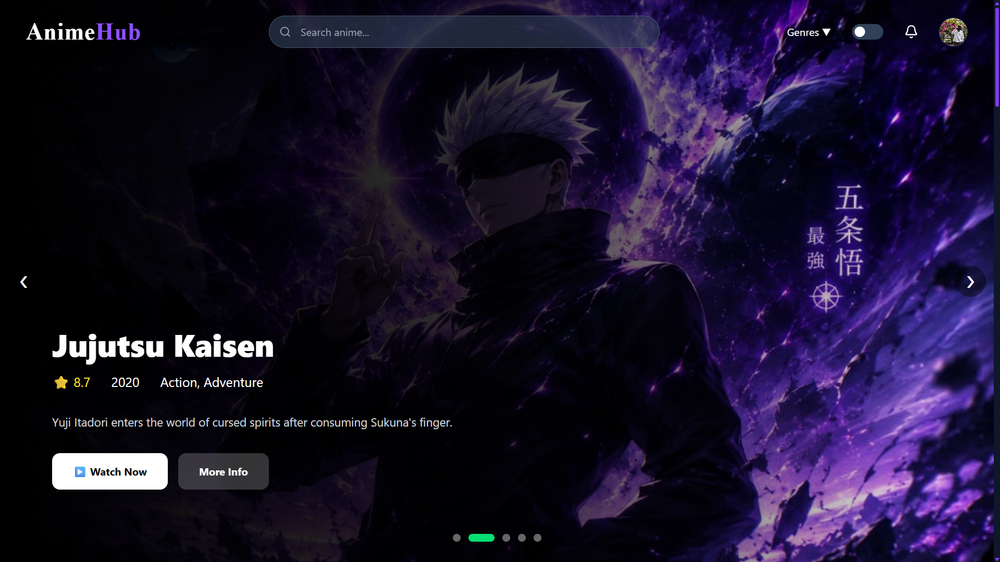
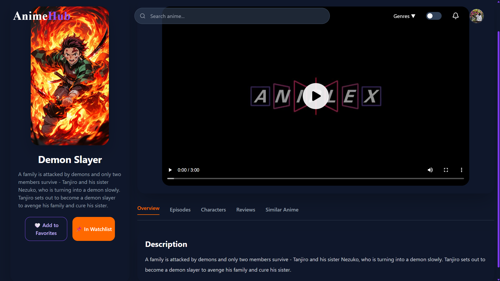
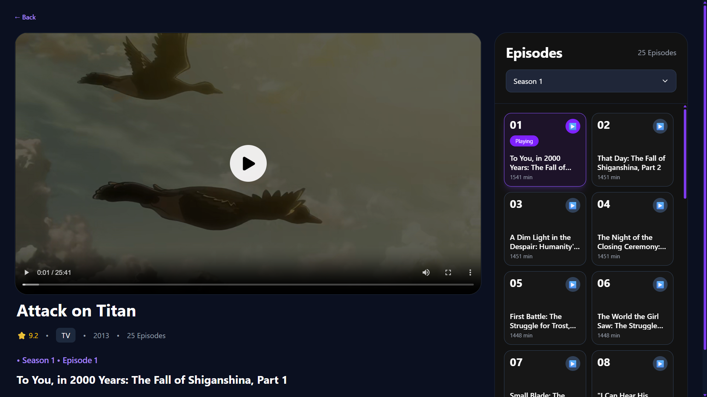
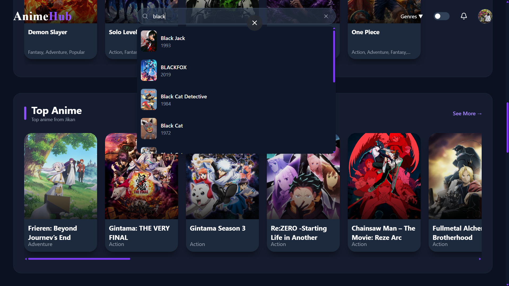
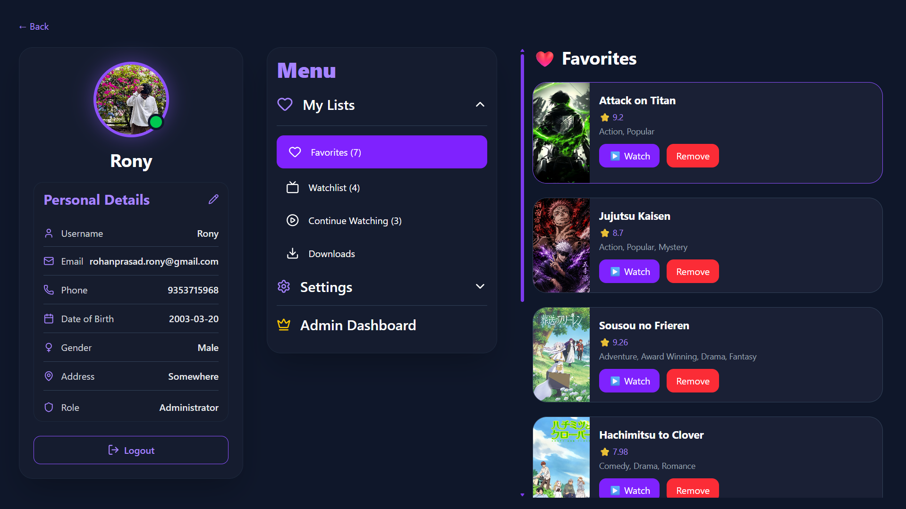
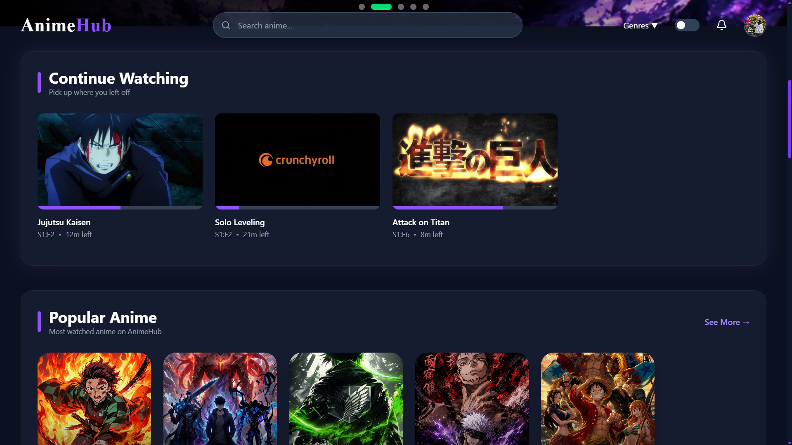
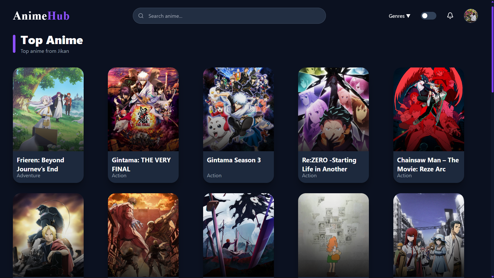
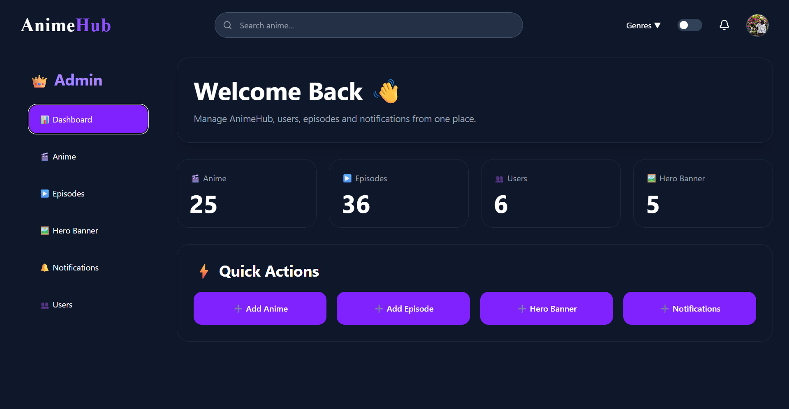

# AnimeHub

A full-stack anime streaming platform built with **React.js, Spring Boot, PostgreSQL, JWT Authentication, and AWS**.

## 📌 About the Project

AnimeHub is a full-stack anime streaming platform where users can browse anime, watch episodes, manage favorites and watchlists, rate and review anime, and continue watching from where they left off.

The project is built using **React.js** for the frontend and **Spring Boot** for the backend, with **PostgreSQL** as the database.

The application also integrates external anime metadata services and AWS cloud services for deployment and media storage.

---

## 🚀 Live Application

### Frontend

https://anime-hub-coral.vercel.app/

---

# ✨ Features

## 👤 User Features

- User registration
- User login
- JWT-based authentication
- Role-based authorization
- Browse anime
- Search anime
- View anime details
- View seasons and episodes
- Watch anime episodes
- Continue watching
- Save favorite anime
- Add anime to watchlist
- Remove anime from favorites
- Remove anime from watchlist
- Rate anime
- Review anime
- View average anime ratings
- Add comments
- View comments
- User profile
- Profile image support
- Secure password handling

---

## 🎬 Anime Features

- Anime browsing
- Trending / top anime section
- Anime details page
- Anime poster and banner support
- Anime description
- Genre information
- Trailer integration
- Episode listing
- Season information
- Episode pagination
- Episode video playback
- Continue watching functionality
- External anime metadata integration

---

## ▶️ Continue Watching

AnimeHub stores the user's watching progress.

When a user pauses an episode, the current playback time is stored.

When the user returns to the episode, AnimeHub can continue from the previously saved position.

The backend uses a dedicated continue-watching system containing:

- User
- Episode
- Watched time
- Updated time

---

# 🔐 Authentication & Authorization

AnimeHub uses **JWT (JSON Web Token)** authentication.

### Authentication Flow

1. User registers an account.
2. Password is encrypted using BCrypt.
3. User logs in.
4. Backend validates the credentials.
5. Backend generates a JWT token.
6. Frontend stores the token.
7. The token is sent with protected API requests.
8. Spring Security validates the token.
9. User receives access according to their role.

### Roles

- `ROLE_USER`
- `ROLE_ADMIN`

Role-based access is implemented using Spring Security and method-level authorization.

---

# 🛡️ Security

The backend uses:

- Spring Security
- JWT Authentication
- BCrypt password encryption
- Role-based authorization
- Protected API endpoints
- Method-level authorization
- CORS configuration
- HTTPS
- Secure external configuration

Sensitive configuration values are stored outside the source code using environment variables and **AWS Systems Manager Parameter Store**.

No passwords, API keys, database credentials, or JWT secrets are stored in the repository.

---

# 👑 Admin Features

Administrators can manage AnimeHub content and platform data.

Admin functionality includes:

- Anime management
- Episode management
- Anime creation
- Anime editing
- Episode creation
- Episode editing
- Episode deletion
- Video upload
- Uploaded content management

Admin-only APIs are protected using role-based authorization.

---

# 🏗️ System Architecture

AnimeHub follows a layered full-stack architecture.

```text
                    ┌─────────────────────┐
                    │       User          │
                    └──────────┬──────────┘
                               │
                               ▼
                    ┌─────────────────────┐
                    │   React Frontend    │
                    │  Vite + Tailwind    │
                    └──────────┬──────────┘
                               │
                         HTTPS / REST
                               │
                               ▼
                    ┌─────────────────────┐
                    │   Spring Boot API   │
                    │      Java 17        │
                    └──────────┬──────────┘
                               │
             ┌─────────────────┼─────────────────┐
             │                 │                 │
             ▼                 ▼                 ▼
      ┌─────────────┐   ┌─────────────┐   ┌─────────────┐
      │ PostgreSQL  │   │   AWS S3    │   │ Jikan API   │
      │     RDS     │   │   Storage   │   │ Anime Data  │
      └─────────────┘   └─────────────┘   └─────────────┘

```

# 🖼️ Screenshots

## 🏠 Home Page



## 🎬 Anime Details



## ▶️ Watch Page



## 🔎 Search & Browse



## 👤 User Profile



## 🔄 Continue Watching



## 🎞️ Anime Cards



## 👑 Admin Dashboard


